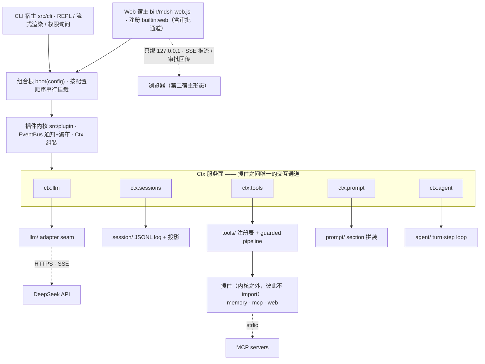
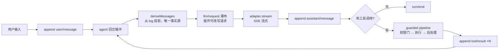

# MiniDSH


> 一个能真正跑起来的 agent 内核：**插件串行挂载、事件瀑布、受保护的工具管道、LLM 适配缝**。
> 1.44 万行 TypeScript，**运行时依赖为零**，760 例测试全绿。

`mdsh` 是一个命令行 agent——有会话、有工具、有权限确认、有上下文压缩、有插件。它对照 [deepseek-harness](https://github.com/deepseek-ai/deepseek-harness)（约 46 万行 TS）做**架构级重写**：只保留四条灵魂，砍掉全部产品化工程，换来的是整套设计能被读完、读懂、改得动。

---

## 30 秒看懂



每个模块自己也是插件，经同一协议挂载——**内核不认识任何具体能力**，表里没有对应名字就 fail-fast。

一个回合里数据是这么走的：



两条不变量贯穿全程：**模型可见的事实只来自 log**（进程内没有第二份对话状态），**错误各有归属**（工具失败是结果并已入 log，LLM 失败是异常上抛给宿主）。

## 硬指标

| 项 | 值 |
|---|---|
| 产品代码 | **14,395 行** TypeScript（不含测试） |
| 运行时依赖 | **0**（SSE 解析、JSON Schema 校验、MCP 客户端、Web 服务全部手写） |
| 测试 | **760 例**（单元测试 + 跨模块集成测试） |
| 模块 | **11 个**（00 骨架 → 10 Web UI 插件），一次一个、逐个交付 |
| 设计文档 | **11 份**逐模块设计 + 1 份架构基线 |
| 门禁 | typecheck / lint / test 三项全绿 |

## 它保留了什么，砍掉了什么

**保留**：插件串行挂载与依赖顺序、瀑布事件与通知、工具契约与执行流水线、JSONL 会话、上下文压缩、权限分层。

**砍掉**：Cordis DI 与可逆 effects / 热替换、三域事件收敛为单一总线、会话多版本迁移链与 zstd、compaction 全家收敛为单一 summarize 策略、capability seams（工具直连本地实现）。

记忆、MCP、Web UI 都是**插件**而非核心——与原版决策一致：记忆来自外部生态，Web UI 走 `dafy-whale-theme` 同款「前端即插件」路线。

## 快速开始

要求 **Node >= 22**。

```bash
pnpm install
pnpm build                  # tsc → dist/
export DEEPSEEK_API_KEY=sk-...
node bin/mdsh.js            # 起 REPL
```

想用 `mdsh` 直接调用：`pnpm link --global`（或把 `bin/mdsh.js` 加进 PATH）。

**零配置即可启动**：不写任何配置文件时，内核会挂载五个内置插件，`model` 默认 `deepseek-chat` + `baseUrl` 默认 `https://api.deepseek.com` + 从环境变量 `DEEPSEEK_API_KEY` 取密钥。也就是说——设好环境变量就能对话。

### Web 界面（蓝色大肥鱼主题）

```bash
pnpm build
node bin/mdsh-web.js           # 打开 http://127.0.0.1:3080/
```

第二宿主形态：`plugins/web/` 是一个**普通插件**（灵魂 #1 的验证载体），核心不认识它。海洋蓝亮/暗双主题、上升气泡、游动鱼群、右下角鲸鱼娘女仆吉祥物（戳一戳摇摆出语录）、输入框上方滚动"每日鱼语"。流式输出逐字到达，工具调用有审批卡片（`ask` 策略的工具在浏览器里点按钮放行）。**只绑回环地址**，非回环拒绝启动；零运行时依赖，无 CDN 外链，完全离线。

| 亮（晴海白昼） | 暗（深海夜） |
|---|---|
|  |  |

## 用法

### 启动 flags

| flag | 作用 |
|---|---|
| `--resume, -r <id>` | 启动时复用指定会话（用 `/sessions` 查 id） |
| `--config-dir <dir>` | 全局配置目录（默认 `~/.minidsh`） |
| `--no-project` | 不读项目层配置 `minidsh.json` |
| `--trust-project` | 跳过项目层**本地插件**的信任确认 |
| `--log-level <level>` | `debug` / `info` / `warn` / `error` |
| `--help, -h` / `--version, -v` | 帮助 / 版本号 |

### 交互

- 直接输入文本即发起一个回合。
- `Ctrl+C` 是**两段式**：第一次取消当前回合，两秒内再按一次退出。
- `/exit` 或 EOF 退出。

### slash 命令

| 命令 | 说明 |
|---|---|
| `/help` | 列出全部命令 |
| `/session` | 当前会话 id 与已跑回合数 |
| `/sessions` | 列出最近 10 个会话 |
| `/tools` | 已注册工具及其权限策略（`auto` / `ask` / `deny`） |
| `/resume <id>` | 切换到指定会话（重启内核） |
| `/exit`、`/quit` | 退出 |

命令表是**宿主主权**的常量表，不是扩展点：插件想加命令得改 `src/cli/commands.ts`（mini 版不为"插件扩展 REPL"留缝）。

## 配置

两层文件 + 内置默认值，后者覆盖前者：

1. 全局 `~/.minidsh/config.json`
2. 项目 `<cwd>/minidsh.json`（**不向上递归查找**）

`permissions` 等对象是三层**逐键深合并**的产物。

```jsonc
{
  "model": { "provider": "deepseek", "name": "deepseek-chat",
             "baseUrl": "https://api.deepseek.com", "apiKeyEnv": "DEEPSEEK_API_KEY" },
  "contextWindow": 131072,
  "tools": { "maxParallel": 4, "bash": { "shell": "auto", "timeoutMs": 120000 } },
  "compaction": { "thresholdRatio": 0.8, "keepTurns": 4 },
  "permissions": { "read": "auto", "glob": "auto", "grep": "auto",
                   "write": "ask", "edit": "ask", "bash": "ask", "mcp__*": "ask" },
  "plugins": [
    { "source": "builtin:llm" }, { "source": "builtin:session" },
    { "source": "builtin:prompt" }, { "source": "builtin:tools" },
    { "source": "builtin:agent-loop" },
    { "source": "./dist/plugins/memory/index.js" },
    { "source": "./dist/plugins/mcp/index.js",
      "config": { "servers": { "github": { "command": "npx", "args": ["-y", "@modelcontextprotocol/server-github"] } } } }
  ]
}
```

要点：

- **`plugins` 为空时由 CLI 兜底**补上五个内置项；一旦你自己写了 `plugins`，就要写全。
- **顺序即挂载顺序**，`builtin:agent-loop` 必须最后——它在 `setup()` 里创建/打开会话，需要前面几个先就位。
- 本地插件的 `source` 必须指向**文件**而非目录（Node ESM 不支持目录 import），且相对路径按 **cwd** 解析：换目录运行会解析失败，建议写绝对路径或在项目根运行。
- 项目层配置里带本地插件时，首次启动要确认信任（`--trust-project` 可跳过）。

### 权限

`auto` 直接执行 / `ask` 需确认 / `deny` 拒绝。匹配规则：**精确键 > 最长前缀通配**（同长取声明序在前）**> 兜底 `ask`**。用最长前缀而非声明序，是为了避免全局层的宽泛规则（如 `mcp__*`）永久压住项目层更严格的规则（如 `mcp__github*`）。裸 `*` 视为配置错误。

### 会话存储

`~/.minidsh/sessions/<id>/session.jsonl`——一会话一目录、单版本 JSONL，无迁移链。

## 插件

### 内置（五个）

`builtin:llm`（DeepSeek provider / SSE 流式）、`builtin:session`（store）、`builtin:prompt`（系统提示段注册表）、`builtin:tools`（工具注册与执行流水线）、`builtin:agent-loop`（回合循环 + 压缩）。

LLM 能力本身也是插件——内核不认识任何 provider，表里没有 `config.model.provider` 这个名字就 fail-fast。

### `memory` 插件

```jsonc
{ "source": "./dist/plugins/memory/index.js",
  "config": { "file": "~/.minidsh/memory/MEMORY.md" } }   // file 可省略，此为默认
```

做两件事：把记忆文件作为**系统提示段**注入，并注册一个 `memory` 工具让模型自己写入。

### `mcp` 插件

```jsonc
{ "source": "./dist/plugins/mcp/index.js",
  "config": {
    "onStartupError": "fail",          // fail（默认，抛错转 BootError）| tolerate（只记 log、零工具）
    "servers": {
      "github": {
        "command": "npx",              // 不做 shell 包装
        "args": ["-y", "@modelcontextprotocol/server-github"],
        "env": { "GITHUB_TOKEN": "$ENV:GITHUB_TOKEN" },   // $ENV:NAME 从父进程取，取不到则启动失败
        "cwd": ".",                    // 缺省继承当前进程
        "startupTimeoutMs": 10000,     // spawn + 握手 + 工具发现的整体预算
        "requestTimeoutMs": 120000     // 单次 tools/call
      }
    }
  } }
```

- 工具统一命名 `mcp__<server>__<tool>`，避免不同 server 的同名工具撞车。
- 传输只做 **stdio**（换行分帧 JSON），不支持 HTTP/SSE。
- **Windows 上 `npx` 要写 `npx.cmd`**，否则 spawn 报 ENOENT。
- 不做重连：server 进程死了就是死了，工具调用返回"连接已终止"。

## 内置工具

`read` `write` `edit` `glob` `grep` `bash`（外加 memory 插件的 `memory`、MCP 插件桥接的 `mcp__*`）。

`bash` 的 `shell: "auto"`：检测到 `bash`（如 Git Bash）用之，否则回退 PowerShell；可在配置里固定。

`/tools` 会标出 `exclusive`——表示该文件/进程类工具不可与其它工具并行（`write` / `edit` / `bash` 都是），其余走 `tools.maxParallel` 并发。

## 设计文档

这个项目是**文档先行**交付的：每个模块先写设计文档（Draft → review → Reviewed）才动代码，实现期间的偏离会回写进文档。这些文档是理解设计意图的第一手材料。

| 文档 | 职责 |
|---|---|
| `docs/architecture.md` | 骨架基线：契约签名、模块依赖顺序、回合数据流（**改动需重新 review**） |
| `docs/design/00-skeleton.md` … `10-web-ui.md` | 逐模块设计，各含决策记录（D1…）与偏离记录（X / Y 两系） |
| `docs/PROGRESS.md` | 跨会话交接的唯一事实源：实绩 LOC、遗留与阻塞、下一步动作 |
| `docs/process.md` | 开发流程规范、模板与 DoD |

## 开发

```bash
pnpm typecheck     # tsc --noEmit
pnpm lint          # eslint
pnpm test          # vitest（760 例）
pnpm build         # tsc → dist/
```

目录：

```
src/        内核（config / llm / session / prompt / tools / agent / plugin / cli）
plugins/    memory、mcp —— 内核之外的插件，彼此不 import
tests/      集成测试与夹具
docs/       architecture.md（基线）、process.md（流程）、design/NN-*.md（逐模块设计）、PROGRESS.md（交接）
bin/mdsh.js CLI 入口
```

新会话接手开发时，读 `AGENT.md` → `docs/PROGRESS.md` → 当前模块设计文档。
